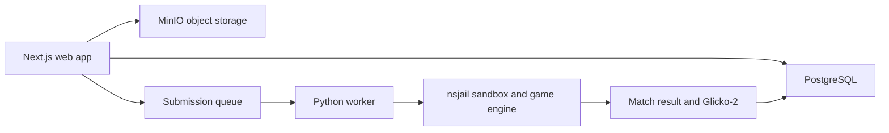

<div align="center">
  

  <p>
    
    
    
    <a href="LICENSE"></a>
  </p>
</div>

## 🌠 The game

Nexus Wars is a bot-battle platform set in a deterministic space strategy simulation. Players submit Python agents; a separate worker extracts and runs them in a Linux sandbox, records match results, and updates Glicko-2 ratings.

<p align="center"></p>

## 🛰️ System map



## 🧰 Stack

| Layer | Tools |
|---|---|
| Web | Next.js 16, React, TypeScript, Tailwind, Drizzle |
| Identity | Firebase Auth |
| Worker | Python 3, nsjail sandbox |
| Data | PostgreSQL 16, MinIO |
| Local environment | Docker Compose |

## 🚀 Local development

Prerequisites: Docker Desktop/WSL2, Node.js 20+, Python 3.10+.

```bash
git clone https://github.com/ChristopherJoshy/Nexus-Wars.git
cd nexus-wars
cd services/web
npm install
npm run dev
```

From the repository root, start local services with Docker Compose:

```bash
docker compose -f deploy/docker-compose.yml up -d postgres minio mc
docker compose -f deploy/docker-compose.yml up -d worker
```

Firebase service-account configuration and the `NEXT_PUBLIC_FIREBASE_*` variables are needed for authenticated flows. See the deployment files and environment examples; keep credentials outside Git.

## 🧪 Tests

```bash
python -m pytest tests/ -q
python services/worker/rating/test_glicko2.py
```

## 🧑‍🚀 Bot contract

A submitted Python agent receives an observation and game configuration, then returns actions in the engine's expected format. Read `services/worker/engine/nexus_wars/nexus_wars.json` and the included local test tools before writing an agent.

## 🗂️ Layout

```text
services/web/       Next.js app and API
services/worker/    match orchestration, engine, rating and sandbox
deploy/             Docker Compose and container setup
migrations/         database migrations
tests/              worker and engine tests
```

## 📄 License

MIT. See [`LICENSE`](LICENSE).

## ⚠️ Notes

The worker sandbox is Linux-specific and relies on nsjail. A local development setup is not a production security review; inspect sandbox limits and submission handling before exposing it to untrusted uploads.
